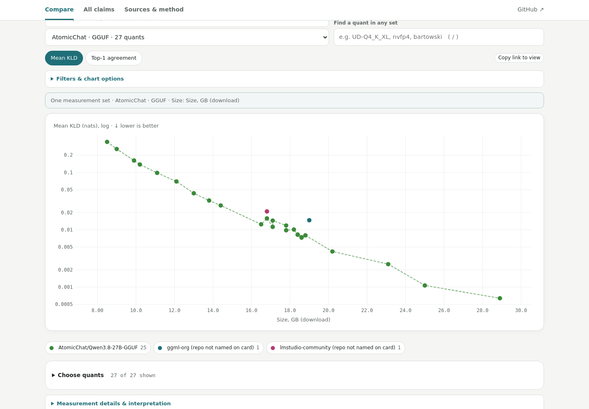
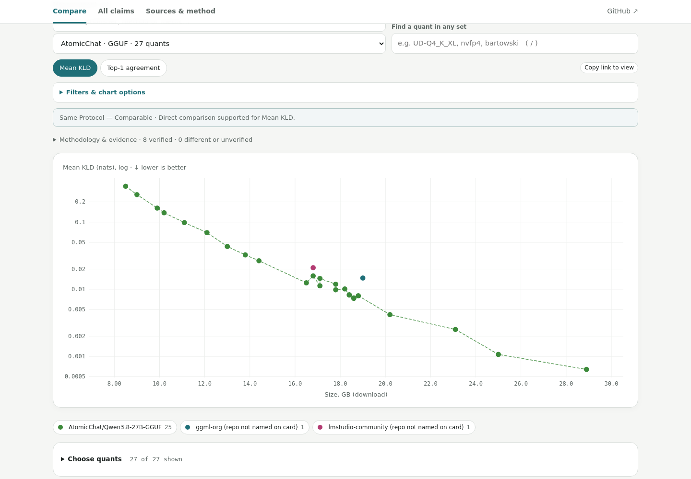
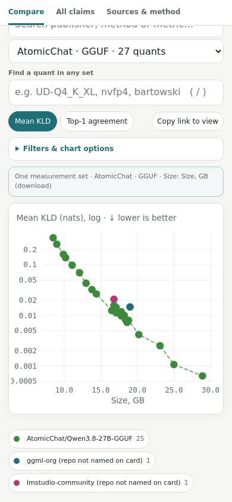
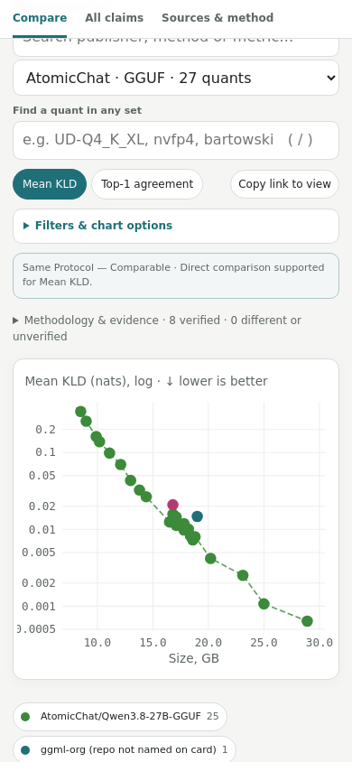

# Qwen3.8-27B comparison previews

Actual rendered chart at `?set=a-atomicchat-gguf&m=kld#chart`; 27 points preserved. Captured at 1440×1000 desktop and 390×844 mobile. These files are review artifacts; they are not a deployment.

| View | Before | After |
|---|---|---|
| Desktop |  |  |
| Mobile |  |  |

[Expanded methodology — desktop](after-methodology-desktop.png) · [Expanded methodology — mobile](after-methodology-mobile.png) · [Mixed overview — mobile](after-overview-mobile.png)

The chart retains its data, metric and scale. The added status explains eligibility; evidence and limitations expand on demand. See the [implementation and evidence rules](../../COMPARISON_CLASSIFICATIONS.md).
