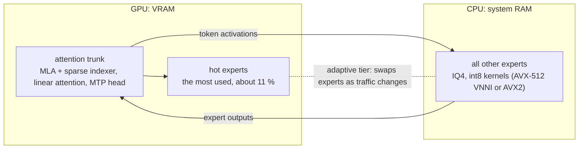

# GLM-5.3-Flash Phobos GGUF

**GLM-5.3-Flash on one NVIDIA GPU plus system RAM, for [Phobos](https://github.com/mussonking/Phobos).**

[](LICENSE)
[](https://huggingface.co/zai-org/GLM-5.3-Flash)
[](https://github.com/mussonking/Phobos)

GGUF quantizations of [zai-org/GLM-5.3-Flash](https://huggingface.co/zai-org/GLM-5.3-Flash), made for **Phobos**
(a fork of [Strata](https://github.com/Niko1221/Strata)): its engine runs the model on a single NVIDIA card and a
large amount of system RAM, and serves a web chat and OpenAI / Anthropic compatible endpoints for coding agents such
as Claude Code.

## Files

| quant | file | size | for | status |
|---|---|---|---|---|
| **IQ4** | `GLM-5.3-Flash-Phobos-IQ4.gguf` | 179.1 GB (166.8 GiB) | 24 GB+ GPU, 192 GB+ RAM | available, tested |
| Q3 | | | 16-24 GB GPU, 64 GB RAM + NVMe | coming, being measured |
| Q2 (experimental) | | | 16-24 GB GPU, 64 GB RAM + NVMe | coming, being measured |

Shared by every quant:

| file | size | what |
|---|---|---|
| `expert-profile-agent.strp` | 100 KB | optional: which experts to put on the GPU first, measured on coding-agent traffic |
| `tokenizer/` | 7.5 MB | vocab, merges and chat template, extracted from the GGUF |
| `needles/` | 2.2 MB | 6 long-context test prompts (95 K and 113 K tokens), for test reports |
| `LICENSE` | | Z.ai's MIT license for the weights |
| `SHA256SUMS` | | sha256 of every file |

No numbers are promised for the Q3 and Q2 until they are measured.

## Headline numbers (IQ4)

One Tesla V100 32 GB (PCIe 3), 2 x Xeon Gold 6252, 376 GB RAM, AVX-512 VNNI path, quiet machine:

| | measured |
|---|---|
| reading a long prompt (95 K and 113 K tokens) | **616-626 tokens/s** (113 K tokens in 181 s) |
| writing at 95-113 K tokens of context | **29-33 tokens/s** |
| writing, short context | **26 tokens/s** |
| first token of a follow-up turn (200 new tokens) | **1.1 s** |
| needle-in-a-haystack at 95 K and 113 K tokens | **6 / 6 found** |

The long-context writing figures come from the needle answers, which are short and predictable: speculative decoding
accepts most drafts there. Expect less on free-form writing. More below.

## How it runs



- The attention trunk and the most used experts (1353, 17.2 GB on our V100) live on the GPU.
- The other experts stay in RAM; the CPU computes them with int8 kernels.
- The model's own MTP head drafts tokens for speculative decoding (`--spec 1`).

## What is in the IQ4 GGUF

| tensors | type |
|---|---|
| routed experts, gate and up | IQ4_XS (4.25 bits per weight) |
| routed experts, down | IQ4_NL (4.5 bits per weight) |
| the rest of the trunk (attention, dense and shared feed-forward) | Q8_0 |
| 332 small trunk tensors: MLA projections, hyper-connection mixers, the sparse-attention indexer, linear-attention gates | BF16 |
| norms | F32 |

- Expert payload 168.8 GB of the 179.1 GB.
- The MTP layer (the model's own draft head) is kept.
- Made with llama.cpp's `llama-quantize` from [unsloth's BF16 GGUF](https://huggingface.co/unsloth/GLM-5.3-Flash-GGUF),
  with unsloth's importance matrix.
- Every expert quantization type was checked against llama.cpp's reference kernels on the CPU (AVX-512 VNNI) and on
  the GPU.
- Architecture `glm5-next` (llama.cpp mainline). The file uses only mainline tensor types. We have not tested it in
  llama.cpp itself.
- **Text only.** GLM-5.3-Flash is natively multimodal. This GGUF and the engine handle text; images are not supported.

### What differs from other GGUFs of this model

unsloth's closest file, UD-IQ4_XS, is 156.8 GB in 5 shards:

- gate/up experts mostly IQ3_S;
- down experts IQ4_XS, with Q4_K / Q6_K in a few layers;
- the small trunk tensors in Q8_0; the output in Q6_K.

Phobos's engine needs IQ4_XS gate/up and IQ4_NL down in every layer, so it cannot run unsloth's files. This one has:

- **All experts at 4 bits, the trunk at 8.** The types match the engine's expert kernels:
  - the CPU repacks the IQ4 experts at load for its AVX-512 VNNI path;
  - the GPU reads them as they are;
  - the trunk always sits on the GPU, so it gets Q8_0.
- **An expert profile measured on agent work.** The 100 KB profile ranks the experts by how often a coding agent's
  traffic routes to them.
  - Source: ~74 K tokens of real Claude Code sessions run through `llama-imatrix`. It stores counts only, none of the
    text.
  - With it, the GPU starts with the experts an agent uses most. Without it, the engine starts from its own ranking.
  - Either way, the adaptive tier then learns from your traffic.
  - The profile is not the quantization's importance matrix: the weights use unsloth's.

## Speed in detail (IQ4)

Same machine; 1353 experts (17.2 GB) in VRAM; 2 conversations of 131072 tokens each; `--spec 1`.

Writing (decode), short context, quiet machine:

| CPU kernel path | tokens/s |
|---|---|
| AVX-512 VNNI, R8 layout (the default on this CPU) | 26.0 |
| AVX2 (AVX-512 switched off with `GLM_CPU_ISA=avx2`) | 21.1 |

Time to the first token for a follow-up turn of N new tokens:

| new tokens | VNNI | AVX2 |
|---|---|---|
| 200 | 1.1 s | 12.3 s |
| 800 | 2.3 s | 14.8 s |
| 2000 | 4.3 s | 16.3 s |

The AVX2 path uploads its prompt experts to the GPU instead of sharing the work with the CPU. On PCIe 3 it is bound
by that upload.

Long conversations, 95-113 K tokens of context:

| | VNNI, quiet | VNNI, under background load | AVX2, under background load |
|---|---|---|---|
| writing | 29-33 tokens/s | 21-25 tokens/s | 22-25 tokens/s |
| reading a new long prompt (cold) | 616-626 tokens/s (113 K: 181 s) | ~600-680 tokens/s | ~440 tokens/s |

- At this length, a whole AVX2 turn takes ~1.3-1.4x as long as on VNNI.
- Loading takes ~2 min from NVMe.
- **Desktops (projected, not measured):** 2-channel DDR5 gives ~55-60 GB/s against ~280 GB/s here; expect roughly
  10-15 tokens/s writing. A 24 GB card also holds fewer experts than our 32 GB one.

## Requirements (IQ4)

| | minimum | better |
|---|---|---|
| OS | Linux x86-64 (WSL2 being verified) | |
| RAM | 192 GB | 256 GB+ (room for the prefix cache) |
| GPU | NVIDIA, compute capability 8.0+ (RTX 30 / 40 / 50, A-series), 24 GB | more VRAM: more experts on the GPU |
| | V100 (sm_70) as an experimental build | |
| CPU | AVX2 | AVX-512 VNNI (Xeon Cascade Lake or newer, AMD Zen 4 / Zen 5) |
| Disk | ~180 GB, NVMe | |

- Memory bandwidth sets the speed: each generated token reads ~3 GB of experts from RAM.
- 192 GB of RAM rules out most desktops; AM5 and LGA1700 / LGA1851 boards with 192 GB+ work.
- Intel LGA1700 / LGA1851 have no AVX-512, so they run the AVX2 path.

## Tested hardware

| GPU | what was tested |
|---|---|
| Tesla V100 32 GB (sm_70, experimental build), 376 GB RAM | the full model: every number above, long-context needles 6/6 at 95 K and 113 K tokens (VNNI and AVX2) |
| RTX 3080 10 GB (sm_86), WSL2 | a mini model only (the real engine, a few experts per layer): all 18 checks pass, the WSL2 pinned-memory path included |
| 24 GB cards (RTX 3090, 4090, ...) | **untested: reports welcome** (see below) |

## Run it

```sh
pip install -U huggingface_hub
hf download mussonking/GLM-5.3-Flash-Phobos-GGUF \
    --include "GLM-5.3-Flash-Phobos-IQ4.gguf" "expert-profile-agent.strp" "tokenizer/*" \
    --local-dir /models/glm
```

Then build Phobos and start the server: [quick start](https://github.com/mussonking/Phobos#quick-start). The server
starts the engine for you:

```sh
glm_serve --gguf GLM-5.3-Flash-Phobos-IQ4.gguf --profile expert-profile-agent.strp \
          --ctx 131072 --sessions 2 --kv-latent auto --spec 1
```

- Greedy decoding only.
- One GPU, one request generating at a time.
- Thinking effort: Low, High or Max (`reasoning_effort`). No effort means Max, the model's default.

## Report a test

You can help if you have a 24 GB card (3090, 4090, ...), a desktop with 192 GB, or WSL2. Open an issue on
[mussonking/Phobos](https://github.com/mussonking/Phobos/issues) with:

- `curl http://127.0.0.1:8142/health`: the JSON. It includes `cpu_isa`, the expert layout and the number of VRAM
  slots;
- the engine log;
- the needle results: `tools/glm/needle_http.py needles/ --url http://127.0.0.1:8142 --key-file <file>` (in the
  Phobos repo), with this repo's `needles/`.

## Credits

- **[Z.ai](https://huggingface.co/zai-org/GLM-5.3-Flash)**: GLM-5.3-Flash, its weights, tokenizer and chat template
  (MIT, Copyright (c) 2026 Z.AI Co., Ltd; see `LICENSE`).
- **[unsloth](https://huggingface.co/unsloth/GLM-5.3-Flash-GGUF)**: the BF16 GGUF conversion this file was quantized
  from, and the importance matrix used to quantize it (MIT).
- **[llama.cpp / ggml](https://github.com/ggml-org/llama.cpp)** and their authors (MIT): the IQ4_XS / IQ4_NL formats,
  `llama-quantize` (which made this GGUF), `llama-imatrix` (which measured the expert profile), and the `glm5-next`
  implementation the engine's forward pass was written from.
- **[Strata](https://github.com/Niko1221/Strata)** by Niko1221 and the Strata contributors (MIT): the project Phobos
  forks.
- **The research behind the architecture:** Multi-head Latent Attention (DeepSeek-V2,
  [arXiv:2405.04434](https://arxiv.org/abs/2405.04434)); DeepSeek Sparse Attention (DeepSeek-V3.2,
  [arXiv:2512.02556](https://arxiv.org/abs/2512.02556)); Kimi Delta Attention (Kimi Linear,
  [arXiv:2510.26692](https://arxiv.org/abs/2510.26692), after Gated DeltaNet,
  [arXiv:2412.06464](https://arxiv.org/abs/2412.06464)); mHC ([arXiv:2512.24880](https://arxiv.org/abs/2512.24880),
  after Hyper-Connections, [arXiv:2409.19606](https://arxiv.org/abs/2409.19606)).
- Related work, no code shared: [sergqwer/strata-glm](https://github.com/sergqwer/strata-glm) (NVFP4 experts on an
  RTX 5090; archived), [glm53-flash-offload](https://github.com/sybil-solutions/glm53-flash-offload) by 0xSero
  (exllamav3, EXL3 3.05 bpw, RTX 3090).

Not affiliated with or endorsed by Z.ai, unsloth, the llama.cpp authors or Strata's author.

## License

- Weights: MIT, Z.ai's ([zai-org/GLM-5.3-Flash](https://huggingface.co/zai-org/GLM-5.3-Flash); `LICENSE` in this
  repo).
- Expert profile, needle prompts, this card: MIT, Copyright (c) 2026 mussonking.

If you use the model, cite Z.ai's report:

```bibtex
@misc{glm5team2026glm5vibecodingagentic,
  title={GLM-5: from Vibe Coding to Agentic Engineering},
  author={GLM-5-Team},
  year={2026},
  eprint={2602.15763},
  archivePrefix={arXiv}
}
```
