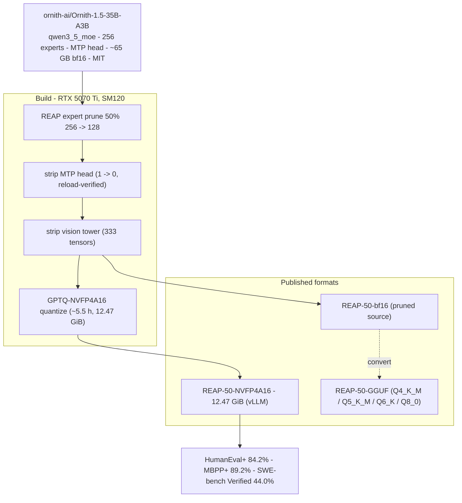

# Ornith-1.5-35B-A3B · REAP-50 — GGUF

GGUF quants of the **50%-REAP-pruned** Ornith-1.5-35B-A3B (Gated-DeltaNet + MoE
hybrid): 256 → 128 experts, MTP head removed, `~19B` parameters. Likely the
first GGUF of any 50%-REAP-pruned model.

- **Flagship (NVFP4A16, vLLM):** [`Ttimms/Ornith-1.5-35B-A3B-REAP-50-NVFP4A16`](https://huggingface.co/Ttimms/Ornith-1.5-35B-A3B-REAP-50-NVFP4A16)
- **Pruned bf16 source:** [`Ttimms/Ornith-1.5-35B-A3B-REAP-50-bf16`](https://huggingface.co/Ttimms/Ornith-1.5-35B-A3B-REAP-50-bf16)
- **Pipeline + benchmarks:** <https://github.com/t-timms/ornith-nvfp4>

Base model quality (NVFP4A16, before GGUF quant): HumanEval+ 84.2%, MBPP+ 89.2% — single greedy draws; see the [NVFP4A16 card](https://huggingface.co/Ttimms/Ornith-1.5-35B-A3B-REAP-50-NVFP4A16#evaluation) on run-to-run spread.

## Architecture



## Download

Grab **one file**, not the whole repo.

| File | Quant | Size | Notes |
|---|---|--:|---|
| [`ornith-reap50-Q4_K_M.gguf`](https://huggingface.co/Ttimms/Ornith-1.5-35B-A3B-REAP-50-GGUF/blob/main/ornith-reap50-Q4_K_M.gguf) | Q4_K_M | 11.4 GB | **recommended** — fits 16 GB with room for context |
| [`ornith-reap50-Q5_K_M.gguf`](https://huggingface.co/Ttimms/Ornith-1.5-35B-A3B-REAP-50-GGUF/blob/main/ornith-reap50-Q5_K_M.gguf) | Q5_K_M | 13.3 GB | higher quality, tighter KV budget |
| [`ornith-reap50-Q6_K.gguf`](https://huggingface.co/Ttimms/Ornith-1.5-35B-A3B-REAP-50-GGUF/blob/main/ornith-reap50-Q6_K.gguf) | Q6_K | 15.3 GB | near-lossless; little headroom on 16 GB |
| [`ornith-reap50-Q8_0.gguf`](https://huggingface.co/Ttimms/Ornith-1.5-35B-A3B-REAP-50-GGUF/blob/main/ornith-reap50-Q8_0.gguf) | Q8_0 | 19.7 GB | needs >16 GB or CPU offload |

MoE with ~3B active parameters — CPU / Apple-Silicon inference is fast for the size.
For full precision, re-quantizing, or merging, use the
[pruned bf16 source](https://huggingface.co/Ttimms/Ornith-1.5-35B-A3B-REAP-50-bf16)
and run `convert_hf_to_gguf.py --no-mtp` yourself.

## Run it in

- [llama.cpp](https://github.com/ggml-org/llama.cpp) — `llama-server -m <file>.gguf -ngl 99`
- [LM Studio](https://lmstudio.ai/) (bundles a recent llama.cpp)
- [koboldcpp](https://github.com/LostRuins/koboldcpp)
- [Jan](https://jan.ai/)
- [text-generation-webui](https://github.com/oobabooga/text-generation-webui)
- Ollama — once its bundled llama.cpp includes this arch (see Requirements)

## Requirements

Needs a **recent llama.cpp** (the `qwen35moe` hybrid arch). Verified with
`llama-server` from a source build. Ollama support pending its bundled-llama.cpp
bump.

```bash
llama-server -m ornith-reap50-Q4_K_M.gguf -ngl 99 --port 8080
```

The chat template defaults to thinking on; pass
`"chat_template_kwargs": {"enable_thinking": false}` for grounded output.

## License

MIT (inherits from Ornith-1.5-35B-A3B). Pruning: REAP
(github.com/CerebrasResearch/reap, with a router-renormalization fix).
