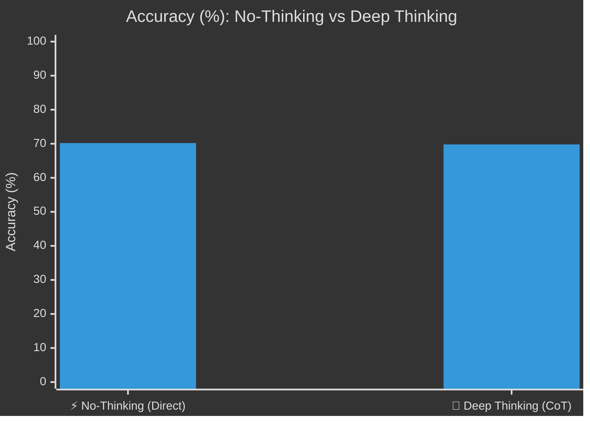
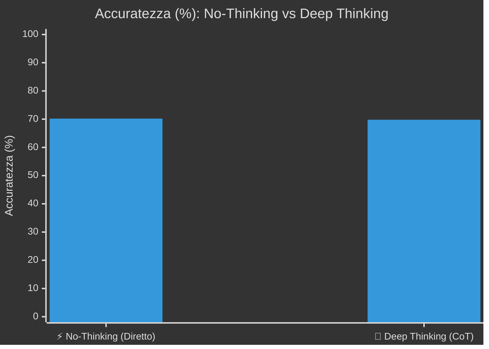

---
language:
- en
- it
license: other
base_model:
- ornith-ai/Ornith-1.5-35B-A3B
tags:
- text-generation
- sigma-studio
- sigmanih
- conversational
- custom-model
pipeline_tag: text-generation
---

<div align="center">

# ⚡ ornith-ai-Ornith-1.5-35B-A3B-GGUF-Q8_0
### High-Performance Model Published via **[Σ-SIGMA Studio](https://github.com/Sigmanih/SigmaStudio)**

[](https://github.com/Sigmanih/SigmaStudio) [](https://huggingface.co/sigmanih/ornith-ai-Ornith-1.5-35B-A3B-GGUF-Q8_0) [](https://github.com/Sigmanih/SigmaStudio) [](https://opensource.org/licenses/Apache-2.0)

</div>

> ❤️ **Support & Community:** If you find this model helpful, please give this repository a **Like** on Hugging Face and a **⭐ Star** on our **[SigmaStudio GitHub](https://github.com/Sigmanih/SigmaStudio)**!

## 🌐 English Overview

**ornith-ai-Ornith-1.5-35B-A3B-GGUF-Q8_0** is a production-ready model optimized and published using the **Model Hub** module of **[Sigma Studio](https://github.com/Sigmanih/SigmaStudio)**.

### ⚙️ Technical Specifications & Architecture
| Specification | Value |
| :--- | :--- |
| **Model Repository** | `sigmanih/ornith-ai-Ornith-1.5-35B-A3B-GGUF-Q8_0` |
| **Weight Format** | `Sconosciuto` (`sconosciuta`) |
| **Base Architecture** | `CausalLM` |
| **Active Parameters** | **35B** |
| **Context Window** | `32,768 tokens` |
| **Total Disk Footprint** | `0.0 GB` |
| **Inference RAM / VRAM** | **`~30.2 GB VRAM`** (Full GPU offload) / **`~28.3 GB RAM`** (CPU/Hybrid) |
| **Recommended Hardware** | Multi-GPU setup (2× 24 GB or RTX 6000) or 64 GB system RAM |
| **Recommended Usage** | Flagship frontier intelligence, Deep research & multi-step mathematics. |

### 🏆 Official Benchmark Performance
Evaluated directly on GPU via **Sigma Studio Training Lab** (Deterministic seed 42, Temp 0.0):

| Benchmark Suite | Score / Accuracy | Total Questions Evaluated | Pass Rate | Test Date | Execution Engine |
| :--- | :---: | :---: | :---: | :---: | :---: |
| **Tutti i Benchmark Ufficiali** | **`70.0%`** | **70/100 quesiti superati** | **`70.0% Pass`** | `2026-09-08` | ⚡ SigmaEngine Direct GPU |

#### 🧠 Reasoning Mode Comparison: No-Thinking vs Thinking
Side-by-side performance comparison between direct zero-overhead answer (*No-Thinking*) and Chain-of-Thought step-by-step reasoning (*Deep Thinking CoT*):

```text
⚡ No-Thinking (Direct Response) : [██████████████░░░░░░] 70.2%  (40/57 passed)
🧠 Deep Thinking (CoT Reasoning) : [██████████████░░░░░░] 69.8%  (30/43 passed)
📈 CoT Performance Delta        : -0.4%
```



| Execution Mode | Accuracy (%) | Questions Passed | Operational Profile & Latency |
| :--- | :---: | :---: | :--- |
| **⚡ No-Thinking (Direct Response)** | **`70.2%`** | `40 / 57` | Minimal latency, immediate token-to-first-byte, zero reasoning tokens overhead |
| **🧠 Deep Thinking (CoT Reasoning)** | **`69.8%`** | `30 / 43` | Multi-step structured reasoning trace (-0.4%), optimal for math & hard logic |

#### 📋 Per-Dataset Evaluation Breakdown

| Dataset / Benchmark Suite | Domain / Category | Correct / Total | Accuracy (%) | Status |
| :--- | :--- | :---: | :---: | :---: |
| **ARC-Challenge** | Science & Grade-School Reasoning | **8 / 9** | `89%` | ✅ Passed |
| **BIG-Bench Hard** | Complex Multi-Task Logic & Symbolics | **6 / 7** | `86%` | ✅ Passed |
| **GPQA** | Graduate-Level Academic Reasoning | **3 / 9** | `33%` | ⚠️ Low |
| **GSM8K** | Multi-Step Grade School Math | **8 / 9** | `89%` | ✅ Passed |
| **HellaSwag** | Commonsense Reasoning & Situational NLI | **5 / 9** | `56%` | ⚡ Fair |
| **HumanEval** | Python Coding (pass@1) | **6 / 7** | `86%` | ✅ Passed |
| **MATH** | Championship Competition Math | **7 / 9** | `78%` | ✅ Passed |
| **MBPP** | Python Programming with Unit Tests | **6 / 9** | `67%` | ⚡ Fair |
| **MMLU** | General Knowledge & Multi-Subject | **7 / 14** | `50%` | ⚡ Fair |
| **MMLU-Pro** | Advanced Multi-Step Reasoning | **6 / 9** | `67%` | ⚡ Fair |
| **TruthfulQA** | Factuality & Anti-Hallucination | **8 / 9** | `89%` | ✅ Passed |
| **🏆 OVERALL TOTAL** | **All Evaluated Datasets** | **`70 / 100`** | **`70%`** | **🏆 70% Pass** |

**Protocol:** code_execution, continuation_logprob, cot_generation, letter_logprob · temp 0.0 · seed 42
**Reproducibility hash:** `SHA256-4B5E077F449E3BAD`
> ⚠️ Measured on a slice of the dataset, not the full suite: this score is not comparable with a full-suite run.

### ⚡ Measured Speed on the Publishing Machine
Measured on `NVIDIA GeForce RTX 5070 Ti` • `15.9 GB VRAM`. Two different numbers follow, and they are not interchangeable.

| What was measured | Value | How |
| :--- | :---: | :--- |
| **Single-stream decode** (what a chat feels) | **`37.4 tok/s`** | one request at a time, on `NVIDIA GeForce RTX 5070 Ti` |
| Prompt processing | `171 tok/s` | same probe |
| Aggregate throughput during evaluation | `36.8 tok/s` | several requests in flight — **not** what a single answer runs at |

> Speeds on other hardware were **not measured** and are not guessed here. A single-stream figure from one machine cannot be scaled into a prediction for another: it depends on memory bandwidth, quantization, context length and driver, and the error is large enough to be misleading.

### 🚀 Quick Start Guide
#### 1. Running with Sigma Studio (Recommended)
Launch **Sigma Studio** to enjoy full 1-click GPU hardware acceleration, live monitoring, and visual chat:
```bash
# Clone and run Sigma Studio
git clone https://github.com/Sigmanih/SigmaStudio.git
cd SigmaStudio
.\sigma_studio.bat
```

#### 2. Running with Transformers / PyTorch
```python
from transformers import AutoModelForCausalLM, AutoTokenizer
import torch

model_id = "sigmanih/ornith-ai-Ornith-1.5-35B-A3B-GGUF-Q8_0"
tokenizer = AutoTokenizer.from_pretrained(model_id)
model = AutoModelForCausalLM.from_pretrained(model_id, torch_dtype=torch.bfloat16, device_map="auto")
```

---
## 🇮🇹 Documentazione in Italiano

**ornith-ai-Ornith-1.5-35B-A3B-GGUF-Q8_0** è un modello ottimizzato pronto per l'inferenza e l'integrazione locale, pubblicato attraverso **[Σ-SIGMA Studio](https://github.com/Sigmanih/SigmaStudio)**.

### 📋 Specifiche e Configurazione
- **Architettura Base:** `CausalLM` (35B parametri)
- **Formato Pesi:** `Sconosciuto` (sconosciuta)
- **Spazio su Disco:** `0.0 GB`
- **RAM / VRAM in Esecuzione:** `~30.2 GB VRAM` (offload GPU completo) | `~28.3 GB RAM` (inferenza CPU/ibrida)
- **Requisiti Hardware Consigliati:** Configurazione Multi-GPU (2× 24 GB o RTX 6000) o 64 GB RAM
- **Finestra di Contesto:** `32,768 token`
- **Profilo d'Uso Consigliato:** Intelligenza di frontiera, ricerca approfondita e matematica multi-step.

### 📊 Risultati Benchmark Ufficiali
- **Suite di Valutazione:** `Tutti i Benchmark Ufficiali`
- **Punteggio Ufficiale:** **`70.0%`** (70/100 quesiti superati)
#### 🧠 Confronto Modalità di Risposta: No-Thinking vs Thinking
Confronto visuale tra risposta istantanea diretta (*No-Thinking*) e ragionamento guidato multi-step (*Deep Thinking CoT*):

```text
⚡ No-Thinking (Risposta Diretta) : [██████████████░░░░░░] 70.2%  (40/57 superati)
🧠 Deep Thinking (CoT Reasoning)  : [██████████████░░░░░░] 69.8%  (30/43 superati)
📈 Delta Prestazionale CoT        : -0.4%
```



| Modalità di Esecuzione | Accuratezza (%) | Quesiti Superati | Profilo Operativo & Latenza |
| :--- | :---: | :---: | :--- |
| **⚡ No-Thinking (Risposta Diretta)** | **`70.2%`** | `40 / 57` | Latenza minima, token-to-first-byte istantaneo, zero overhead di ragionamento |
| **🧠 Deep Thinking (CoT Reasoning)** | **`69.8%`** | `30 / 43` | Risoluzione passo-passo multi-step (-0.4%), ideale per logica complessa e matematica |

#### 📋 Dettaglio Punteggi per Singolo Dataset

| Dataset / Suite di Test | Ambito / Dominio | Corretti / Totale | Accuratezza (%) | Esito |
| :--- | :--- | :---: | :---: | :---: |
| **ARC-Challenge** | Ragionamento Scientifico Avanzato | **8 / 9** | `89%` | ✅ Superato |
| **BIG-Bench Hard** | Logica Complessa & Compiti Multi-Fase | **6 / 7** | `86%` | ✅ Superato |
| **GPQA** | Ragionamento Accademico di Livello Laurea | **3 / 9** | `33%` | ⚠️ Migliorabile |
| **GSM8K** | Matematica & Logica Multi-Step | **8 / 9** | `89%` | ✅ Superato |
| **HellaSwag** | Buon Senso & Comprensione Situazionale | **5 / 9** | `56%` | ⚡ Discreto |
| **HumanEval** | Sintesi Codice Python (pass@1) | **6 / 7** | `86%` | ✅ Superato |
| **MATH** | Matematica Olimpica & Competitiva | **7 / 9** | `78%` | ✅ Superato |
| **MBPP** | Programmazione Python con Unit Test | **6 / 9** | `67%` | ⚡ Discreto |
| **MMLU** | Conoscenza Generale Multidisciplinare | **7 / 14** | `50%` | ⚡ Discreto |
| **MMLU-Pro** | Ragionamento Avanzato Multi-Step | **6 / 9** | `67%` | ⚡ Discreto |
| **TruthfulQA** | Fattualità & Resistenza ad Allucinazioni | **8 / 9** | `89%` | ✅ Superato |
| **🏆 TOTALE COMPLESSIVO** | **Tutti i Dataset Valutati** | **`70 / 100`** | **`70%`** | **🏆 70% Pass** |

**Protocollo:** code_execution, continuation_logprob, cot_generation, letter_logprob · temp 0.0 · seed 42
**Impronta di riproducibilità:** `SHA256-4B5E077F449E3BAD`
> ⚠️ Misurato su una porzione del dataset, non sulla suite intera: il punteggio non è confrontabile con uno ottenuto sull'intero.

- **Data Test:** `2026-09-08` su motore deterministico SigmaEngine

### ⏱️ Throughput Hardware e Fasce Consigliate
- **Velocità Verificata in Locale:** **`36.8 tok/s`** su `NVIDIA GeForce RTX 5070 Ti`.
- **Risposta singola (quello che si sente in chat):** **`37.4 tok/s`** su `NVIDIA GeForce RTX 5070 Ti`.
- **Lettura del prompt:** `171 tok/s`.
- **Throughput complessivo durante la valutazione:** `36.8 tok/s` — piu' richieste in volo insieme, **non** la velocita' di una risposta singola.
- Le velocita' su altro hardware **non sono state misurate** e non vengono indovinate: dipendono da banda di memoria, quantizzazione, lunghezza del contesto e driver.

### ⭐ Supporta il Progetto Open Source
Se questo modello ti è utile o vuoi esplorare l'ecosistema completo:
- 🌟 Metti una **Stella** al repository GitHub: **[Sigmanih/SigmaStudio](https://github.com/Sigmanih/SigmaStudio)**
- ❤️ Lascia un **Like** a questa scheda su Hugging Face

---
*Creato e distribuito con il Model Hub di Σ-SIGMA Studio (30/10/2026 15:57)*