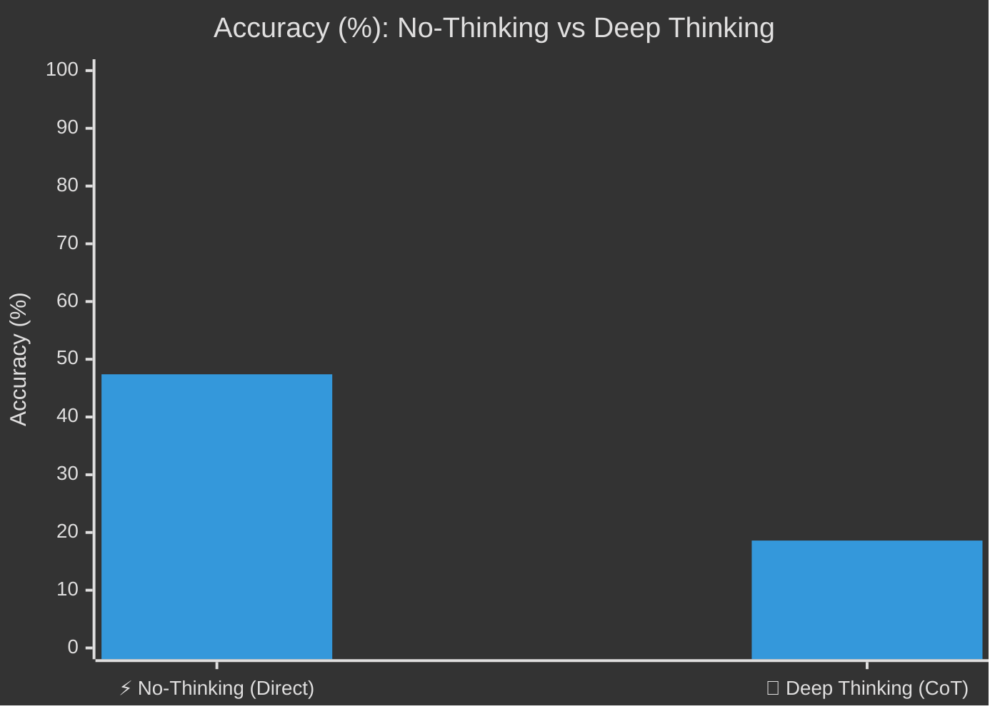
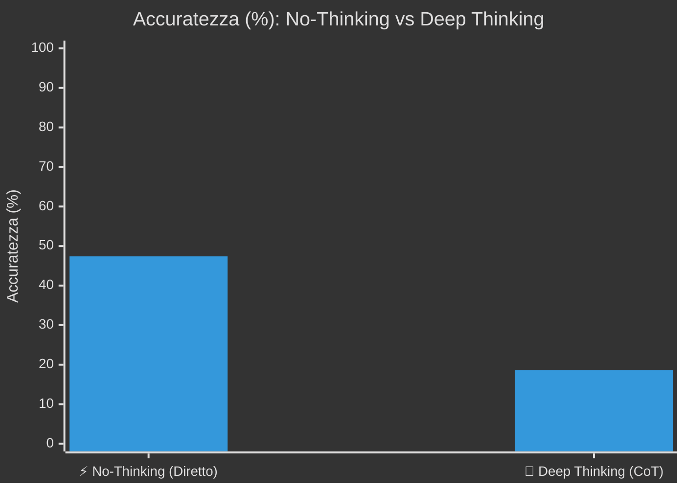

---
language:
- en
- it
license: other
base_model:
- Qwen/Qwen3.8-27B
tags:
- text-generation
- sigma-studio
- sigmanih
- conversational
- custom-model
- gguf
- llama.cpp
- quantized
- iq1_s
pipeline_tag: text-generation
---

<div align="center">

# ⚡ Qwen-Qwen3.8-27B-GGUF-IQ1_S
### High-Performance Model Published via **[Σ-SIGMA Studio](https://github.com/Sigmanih/SigmaStudio)**

[](https://github.com/Sigmanih/SigmaStudio) [](https://huggingface.co/sigmanih/Qwen-Qwen3.8-27B-GGUF-IQ1_S) [](https://github.com/Sigmanih/SigmaStudio) [](https://opensource.org/licenses/Apache-2.0)

</div>

> ❤️ **Support & Community:** If you find this model helpful, please give this repository a **Like** on Hugging Face and a **⭐ Star** on our **[SigmaStudio GitHub](https://github.com/Sigmanih/SigmaStudio)**!

## 🌐 English Overview

**Qwen-Qwen3.8-27B-GGUF-IQ1_S** is a production-ready model optimized and published using the **Model Hub** module of **[Sigma Studio](https://github.com/Sigmanih/SigmaStudio)**.

### ⚙️ Technical Specifications & Architecture
| Specification | Value |
| :--- | :--- |
| **Model Repository** | `sigmanih/Qwen-Qwen3.8-27B-GGUF-IQ1_S` |
| **Weight Format** | `GGUF` (`IQ1_S`) |
| **Base Architecture** | `qwen35` |
| **Active Parameters** | **27B** |
| **Context Window** | `262,144 tokens` |
| **Transformer Layers** | `65` |
| **Hidden Dimension** | `5120` |
| **Total Disk Footprint** | `8.77 GB` |
| **Inference RAM / VRAM** | **`~9.9 GB VRAM`** (Full GPU offload) / **`~9.7 GB RAM`** (CPU/Hybrid) |
| **Recommended Hardware** | GPU with 12-16 GB VRAM (e.g. RTX 3060/4070 or 32 GB RAM) |
| **Recommended Usage** | Advanced logic & reasoning, Enterprise domain specialization, Complex code refactoring. |

### 🏆 Official Benchmark Performance
Evaluated directly on GPU via **Sigma Studio Training Lab** (Deterministic seed 42, Temp 0.0):

| Benchmark Suite | Score / Accuracy | Total Questions Evaluated | Pass Rate | Test Date | Execution Engine |
| :--- | :---: | :---: | :---: | :---: | :---: |
| **Tutti i Benchmark Ufficiali** | **`35.0%`** | **35/100 quesiti superati** | **`35.0% Pass`** | `2026-09-29` | ⚡ SigmaEngine Direct GPU |

#### 🧠 Reasoning Mode Comparison: No-Thinking vs Thinking
Side-by-side performance comparison between direct zero-overhead answer (*No-Thinking*) and Chain-of-Thought step-by-step reasoning (*Deep Thinking CoT*):

```text
⚡ No-Thinking (Direct Response) : [█████████░░░░░░░░░░░] 47.4%  (27/57 passed)
🧠 Deep Thinking (CoT Reasoning) : [████░░░░░░░░░░░░░░░░] 18.6%  (8/43 passed)
📈 CoT Performance Delta        : -28.8%
```



| Execution Mode | Accuracy (%) | Questions Passed | Operational Profile & Latency |
| :--- | :---: | :---: | :--- |
| **⚡ No-Thinking (Direct Response)** | **`47.4%`** | `27 / 57` | Minimal latency, immediate token-to-first-byte, zero reasoning tokens overhead |
| **🧠 Deep Thinking (CoT Reasoning)** | **`18.6%`** | `8 / 43` | Multi-step structured reasoning trace (-28.8%), optimal for math & hard logic |

#### 📋 Per-Dataset Evaluation Breakdown

| Dataset / Benchmark Suite | Domain / Category | Correct / Total | Accuracy (%) | Status |
| :--- | :--- | :---: | :---: | :---: |
| **ARC-Challenge** | Science & Grade-School Reasoning | **6 / 9** | `67%` | ⚡ Fair |
| **BIG-Bench Hard** | Complex Multi-Task Logic & Symbolics | **3 / 7** | `43%` | ⚡ Fair |
| **GPQA** | Graduate-Level Academic Reasoning | **1 / 9** | `11%` | ⚠️ Low |
| **GSM8K** | Multi-Step Grade School Math | **3 / 9** | `33%` | ⚠️ Low |
| **HellaSwag** | Commonsense Reasoning & Situational NLI | **4 / 9** | `44%` | ⚡ Fair |
| **HumanEval** | Python Coding (pass@1) | **3 / 7** | `43%` | ⚡ Fair |
| **MATH** | Championship Competition Math | **0 / 9** | `0%` | ⚠️ Low |
| **MBPP** | Python Programming with Unit Tests | **3 / 9** | `33%` | ⚠️ Low |
| **MMLU** | General Knowledge & Multi-Subject | **5 / 14** | `36%` | ⚠️ Low |
| **MMLU-Pro** | Advanced Multi-Step Reasoning | **1 / 9** | `11%` | ⚠️ Low |
| **TruthfulQA** | Factuality & Anti-Hallucination | **6 / 9** | `67%` | ⚡ Fair |
| **🏆 OVERALL TOTAL** | **All Evaluated Datasets** | **`35 / 100`** | **`35%`** | **🏆 35% Pass** |

**Protocol:** code_execution, continuation_logprob, cot_generation, letter_logprob · temp 0.0 · seed 42
**Reproducibility hash:** `SHA256-65ECA6E1D08A1960`
> ⚠️ Measured on a slice of the dataset, not the full suite: this score is not comparable with a full-suite run.

### 🛠️ Tool Calling & Agentic Protocol Benchmark (Sigma Studio Sandbox Jail)
Empirical multi-turn agent reliability evaluation (zero quizzes, fully grounded file-system actions inside isolated Sandbox Jail):

| Protocol Metric | Outcome | Validation Criteria & Details |
| :--- | :---: | :--- |
| **Tool Protocol Adherence** | **`62.0%`** | `0/92` analytical criteria verified |
| **Autonomous Task Completion** | **`0.0%`** | `0/1` scenarios completed with exact target file |
| **Sandbox Jail Containment** | **`100% Compliant`** | Zero escape attempts outside workspace boundary |
| **Execution Efficiency** | **`0 turns (0.0s)`** | Optimal multi-step turn and token budget usage |

#### 🔍 Certified Autonomous Capabilities:
- ✅ **Tool Grounding:** Exclusively uses registered tools and valid schemas (zero hallucinated functions).
- ✅ **Zero Placeholder Echo:** Emits concrete code and values rather than copy-pasting prompt templates.
- ✅ **Inspect-Before-Edit:** Systematically reads files and verifies target lines before patching.
- ✅ **Evidence-Based Exit:** Emits concrete test commands and validation checks before task exit.
- ✅ **Sandbox Containment:** Strictly adheres to isolated sandbox jail boundaries.

### ⚡ Measured Speed on the Publishing Machine
Measured on `NVIDIA GeForce RTX 5070 Ti` • `15.9 GB VRAM` during the evaluation run.

| What was measured | Value | How |
| :--- | :---: | :--- |
| Aggregate throughput during evaluation | `55.4 tok/s` | several requests in flight — **not** what a single answer runs at |

> Speeds on other hardware were **not measured** and are not guessed here. A single-stream figure from one machine cannot be scaled into a prediction for another: it depends on memory bandwidth, quantization, context length and driver, and the error is large enough to be misleading.

### 🚀 Quick Start Guide
#### 1. Running with Sigma Studio (Recommended)
Launch **Sigma Studio** to enjoy full 1-click GPU hardware acceleration, live monitoring, and visual chat:
```bash
# Clone and run Sigma Studio
git clone https://github.com/Sigmanih/SigmaStudio.git
cd SigmaStudio
.\sigma_studio.bat
```

#### 2. Running with llama.cpp
```bash
llama-cli -hf sigmanih/Qwen-Qwen3.8-27B-GGUF-IQ1_S -p "Hello! How can I help you today?" -ngl 99
```

---
## 🇮🇹 Documentazione in Italiano

**Qwen-Qwen3.8-27B-GGUF-IQ1_S** è un modello ottimizzato pronto per l'inferenza e l'integrazione locale, pubblicato attraverso **[Σ-SIGMA Studio](https://github.com/Sigmanih/SigmaStudio)**.

### 📋 Specifiche e Configurazione
- **Architettura Base:** `qwen35` (27B parametri)
- **Formato Pesi:** `GGUF` (IQ1_S)
- **Spazio su Disco:** `8.77 GB`
- **RAM / VRAM in Esecuzione:** `~9.9 GB VRAM` (offload GPU completo) | `~9.7 GB RAM` (inferenza CPU/ibrida)
- **Requisiti Hardware Consigliati:** GPU con 12-16 GB VRAM (es. RTX 3060/4070 o 32 GB RAM)
- **Finestra di Contesto:** `262,144 token`
- **Profilo d'Uso Consigliato:** Logica e ragionamento avanzato, specializzazione di dominio enterprise, refactoring complesso.

### 📊 Risultati Benchmark Ufficiali
- **Suite di Valutazione:** `Tutti i Benchmark Ufficiali`
- **Punteggio Ufficiale:** **`35.0%`** (35/100 quesiti superati)
#### 🧠 Confronto Modalità di Risposta: No-Thinking vs Thinking
Confronto visuale tra risposta istantanea diretta (*No-Thinking*) e ragionamento guidato multi-step (*Deep Thinking CoT*):

```text
⚡ No-Thinking (Risposta Diretta) : [█████████░░░░░░░░░░░] 47.4%  (27/57 superati)
🧠 Deep Thinking (CoT Reasoning)  : [████░░░░░░░░░░░░░░░░] 18.6%  (8/43 superati)
📈 Delta Prestazionale CoT        : -28.8%
```



| Modalità di Esecuzione | Accuratezza (%) | Quesiti Superati | Profilo Operativo & Latenza |
| :--- | :---: | :---: | :--- |
| **⚡ No-Thinking (Risposta Diretta)** | **`47.4%`** | `27 / 57` | Latenza minima, token-to-first-byte istantaneo, zero overhead di ragionamento |
| **🧠 Deep Thinking (CoT Reasoning)** | **`18.6%`** | `8 / 43` | Risoluzione passo-passo multi-step (-28.8%), ideale per logica complessa e matematica |

#### 📋 Dettaglio Punteggi per Singolo Dataset

| Dataset / Suite di Test | Ambito / Dominio | Corretti / Totale | Accuratezza (%) | Esito |
| :--- | :--- | :---: | :---: | :---: |
| **ARC-Challenge** | Ragionamento Scientifico Avanzato | **6 / 9** | `67%` | ⚡ Discreto |
| **BIG-Bench Hard** | Logica Complessa & Compiti Multi-Fase | **3 / 7** | `43%` | ⚡ Discreto |
| **GPQA** | Ragionamento Accademico di Livello Laurea | **1 / 9** | `11%` | ⚠️ Migliorabile |
| **GSM8K** | Matematica & Logica Multi-Step | **3 / 9** | `33%` | ⚠️ Migliorabile |
| **HellaSwag** | Buon Senso & Comprensione Situazionale | **4 / 9** | `44%` | ⚡ Discreto |
| **HumanEval** | Sintesi Codice Python (pass@1) | **3 / 7** | `43%` | ⚡ Discreto |
| **MATH** | Matematica Olimpica & Competitiva | **0 / 9** | `0%` | ⚠️ Migliorabile |
| **MBPP** | Programmazione Python con Unit Test | **3 / 9** | `33%` | ⚠️ Migliorabile |
| **MMLU** | Conoscenza Generale Multidisciplinare | **5 / 14** | `36%` | ⚠️ Migliorabile |
| **MMLU-Pro** | Ragionamento Avanzato Multi-Step | **1 / 9** | `11%` | ⚠️ Migliorabile |
| **TruthfulQA** | Fattualità & Resistenza ad Allucinazioni | **6 / 9** | `67%` | ⚡ Discreto |
| **🏆 TOTALE COMPLESSIVO** | **Tutti i Dataset Valutati** | **`35 / 100`** | **`35%`** | **🏆 35% Pass** |

**Protocollo:** code_execution, continuation_logprob, cot_generation, letter_logprob · temp 0.0 · seed 42
**Impronta di riproducibilità:** `SHA256-65ECA6E1D08A1960`
> ⚠️ Misurato su una porzione del dataset, non sulla suite intera: il punteggio non è confrontabile con uno ottenuto sull'intero.

- **Data Test:** `2026-09-29` su motore deterministico SigmaEngine

### 🛠️ Benchmark Aderenza Tool & Capacità Agente (Sigma Studio Sandbox Jail)
Valutazione empirica dell'affidabilità nei compiti di agente autonomo (nessun quiz teorico, solo esecuzioni e verifiche su filesystem isolato):

| Metrica di Protocollo | Risultato | Dettaglio e Criteri di Validazione |
| :--- | :---: | :--- |
| **Aderenza Protocollo Tool** | **`62.0%`** | `0/92` prove analitiche verificate |
| **Completamento Scenari Operativi** | **`0.0%`** | `0/1` scenari conclusi con output esatto |
| **Sicurezza Sandbox Jail** | **`100% Conforme`** | Confinamento rigido, zero tentativi fuori sandbox |
| **Efficienza Esecutiva** | **`0 turni (0.0s)`** | Rispetto rigoroso dei budget operativi per scenario |

#### 🔍 Comportamenti Rigorosamente Certificati:
- ✅ **Tool Grounding:** Utilizzo esclusivo di tool formalmente registrati (zero allucinazioni di comandi).
- ✅ **No Segnaposto:** Produzione di codice e parametri concreti senza eco di placeholder d'esempio.
- ✅ **Ispezione Previa:** Lettura e verifica dei file prima di eseguire modifiche chirurgiche.
- ✅ **Verifica di Chiusura:** Certificazione delle prove prima di dichiarare terminato il lavoro.
- ✅ **Confinamento Jail:** Isolamento totale senza contaminazione del kernel o del sistema host.

### ⏱️ Throughput Hardware e Fasce Consigliate
- **Velocità Verificata in Locale:** **`55.4 tok/s`** su `NVIDIA GeForce RTX 5070 Ti`.
- **Throughput complessivo durante la valutazione:** `55.4 tok/s` — piu' richieste in volo insieme, **non** la velocita' di una risposta singola.
- Le velocita' su altro hardware **non sono state misurate** e non vengono indovinate: dipendono da banda di memoria, quantizzazione, lunghezza del contesto e driver.

### ⭐ Supporta il Progetto Open Source
Se questo modello ti è utile o vuoi esplorare l'ecosistema completo:
- 🌟 Metti una **Stella** al repository GitHub: **[Sigmanih/SigmaStudio](https://github.com/Sigmanih/SigmaStudio)**
- ❤️ Lascia un **Like** a questa scheda su Hugging Face

---
*Creato e distribuito con il Model Hub di Σ-SIGMA Studio (13/10/2026 17:53)*