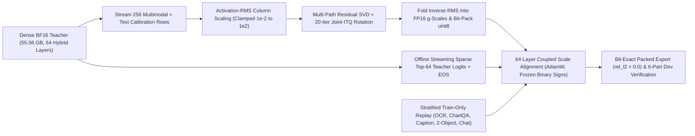

# Binary Latent Matrix Factorization for a 27B Hybrid Vision-Language Model: LittleBit-2 Recovery of Qwen3.8-27B on a Single Consumer GPU

> **Status: Technical Research Teaser (Work in Progress).** All evaluation metrics below are verified on internal development splits; held-out confirmation splits remain sealed. Full training, factorization, and evaluation source code is **available on request**.

## Key Findings at a Glance

Starting from a degraded **1.0 BPW** LittleBit-2 packed baseline of **Qwen3.8-27B** (a 64-layer, 55.56 GB BF16 hybrid **3:1 Gated DeltaNet linear-attention + full-attention** multimodal vision-language model), systematic algorithmic recovery on a **single consumer RTX 5090 (32 GB)** produced the following verified results:

* **1.09x Perplexity of Dense BF16 at 3.66x Compression:** Our flagship `3.0 BPW` 6-path binary-factorized checkpoint (**15.18 GB total**, `< 47%` of RTX 5090 VRAM) achieves **2.1548** dev text NLL vs. **2.0690** for the 55.56 GB dense BF16 teacher (`+0.0858` nats, **1.090x** perplexity ratio, clearing a frozen `1.50x` gate by `0.319` nats) and drops broad dev text NLL (`59,234` tokens) by **-0.7387 nats** (`95% CI [-0.7780, -0.7011]`).
* **100% of Dense BF16 ChartQA Accuracy and 98.5% of BF16 OCR Consensus:** Visual reasoning recovered to **65.63%** on ChartQA (exact match to dense BF16 **65.63%**) and **79.38%** OCR consensus on TextVQA (**98.45%** of dense BF16 **80.63%**, with **68.75%** exact-majority accuracy), with **0 blank** and **0 repeated-fragment** outputs across 116 dev generation cases and **5/5** visual/text image-dependence controls passing.
* **First Complete Multi-Step Czech Einstein Riddle Solve:** On a hard 5-house Czech constraint-satisfaction benchmark (5 attributes x 5 houses, non-English), earlier 1.0-2.0 BPW checkpoints collapsed into short guesses or loops. The aligned `3.0 BPW` 6-path checkpoint completed an 8,932-token structured `<think>` chain-of-thought trace, proved uniqueness, produced the full 5x5 assignment table, and derived the exact answer (`Němec` / the German keeps the fish).
* **Exact Packed Reload Parity and Deterministic KV-Cache Fidelity:** Every exported checkpoint passed `rel_l2 = 0.000e+00` bit-exact reload parity, `48/48` argmax agreement on forced incremental decode within the measured BF16 cache envelope (`max_rel_l2 = 0.0204 <= 0.0333`), and `32/32` token/EOS parity (`0` pre-EOS misses) on a 32-fixture multimodal natural-cache suite (`90.6%` to `96.9%` exact gold match across Pareto points).
* **Empirical Negative Results That Saved Weeks of Compute:** Controlled ablations demonstrated why several textbook quantization ideas fail on pre-converged LittleBit-2 hybrid VLMs:
  1. **Short-horizon STE QAT (~1M tokens) hurts rather than helps:** Both Lion and gradient-magnitude-aware RMS-Momentum STE sign updates flipped `0.3%` to `3%` of signs across isolated 2-layer windows and degraded NLL every single time, breaking the orthogonal Joint-ITQ Procrustes geometry faster than short-horizon gradients can recover.
  2. **Iso-byte path-splitting (`6p x r/3` or `8p x r/4`) loses to `4p x r/2`:** Cutting per-path SVD rank below critical spectral mass hurts more than adding extra residual paths helps.
  3. **Activation-RMS-weighted SVD + Joint-ITQ + 64-layer coupled sparse top-K KL scale alignment** drove the dominant gains: zero-shot `6p x r` RMS-SVD+ITQ alone dropped dev text NLL from `2.8048` to **`2.3674`** before a single gradient step, and coupled 64-layer scale distillation dropped it another `-0.2126` nats to **`2.1548`**.
* **Honest Accounting of Footprint vs. the Original LittleBit Papers:** Our best checkpoint is **15.18 GB** rather than a headline sub-1-bit size (`~3-4 GB`). Exact tensor accounting explains why: **6.06 GB** is an unquantized BF16 dense floor (untied 248K-vocab `embed_tokens` + `lm_head` at `5.09 GB`, ViT vision encoder at `0.92 GB`, and norms/Gated DeltaNet recurrent states at `0.05 GB`), while the 24.33B quantized decoder linears occupy **9.12 GB** (`2.998 BPW`). We also retain compact **9.95 GB** (`1.28 BPW` backbone) and **10.32 GB** (`1.40 BPW` backbone, `1.46x` PPL) checkpoints and outline a concrete roadmap back toward sub-2-bit / 1-bit footprints.

---

## Visual Overview: Pareto Frontier, Multimodal Recovery, and Per-Layer Error


---

## Problem Statement and Architecture

### Target Model: Qwen3.8-27B Hybrid Vision-Language Architecture

Unlike pure-text standard transformers evaluated in the original LittleBit (NeurIPS 2025, [arXiv:2506.13771](https://arxiv.org/abs/2506.13771)) and LittleBit-2 (ICML 2026, [arXiv:2603.00042](https://arxiv.org/abs/2603.00042)) papers, **Qwen3.8-27B** introduces three compounding compression challenges:

1. **Hybrid 3:1 Recurrent-Attention Backbone (64 Layers):** 48 layers use **Gated DeltaNet** linear attention (`in_proj_qkv`, `in_proj_z`, `out_proj`, plus small 1D convolution and decay parameters) interleaved with 16 **full grouped-query attention** layers (24 query heads, 4 KV heads, every 4th layer: `L3, L7, ..., L63`), with `hidden_size = 5120` and `intermediate_size = 17408`. Errors in early recurrent projections propagate multiplicatively across long sequences.
2. **Multimodal Vision-Language Coupling:** A `0.92 GB` BF16 ViT vision tower feeds dense visual tokens directly into the quantized decoder. Chart reading (ChartQA) and fine-grained scene/document text recognition (OCR / TextVQA) are sharply sensitive to quantization noise in lower and middle decoder layers (`L0-L39`).
3. **Large Untied Vocabulary Overhead:** With `vocab_size = 248,320` and untied BF16 `embed_tokens` (`2.543 GB`) + `lm_head` (`2.543 GB`), non-backbone dense parameters impose a **6.060 GB** storage floor before a single decoder matrix is encoded (after reclaiming `0.849 GB` of unused multi-token prediction head weights).

### Mathematical Representation (LittleBit / LittleBit-2)

Each of the **400** large decoder linear matrices $W \in \mathbb{R}^{m \times n}$ (`24.33B` total linear parameters) is factorized into $P$ residual binary paths:

$$\widehat{W} = \sum_{p=0}^{P-1} \operatorname{diag}(h_p)\, U_{b,p}\, \operatorname{diag}(l_p)\, V_{b,p}^{\top}\, \operatorname{diag}(g_p), \qquad U_{b,p} \in \{-1, +1\}^{m \times r},\; V_{b,p} \in \{-1, +1\}^{n \times r}$$

where $h_p \in \mathbb{R}^m$, $l_p \in \mathbb{R}^r$, and $g_p \in \mathbb{R}^n$ are FP16 row, latent, and column scale vectors, and the binary sign matrices are bit-packed into `uint8`.

### Starting Point vs. Recovery Pipeline

We started from an existing `1.0 BPW` (2-path) packed baseline (**9.948 GB** total, including `0.849 GB` of dead MTP weights) that exhibited severe degradation: **2.8048** dev text NLL (`2.09x` BF16 PPL), **3.0124** broad dev text NLL, **56.25%** ChartQA, **56.25%** OCR consensus (`43.75%` exact), `25/32` natural cache gold, and complete failure on the Czech Einstein riddle.



Key engineering pillars of the recovery pipeline:

1. **Activation-RMS-Weighted Multi-Path Initialization:** Instead of unweighted Frobenius SVD, each weight matrix is scaled by normalized input-channel activation RMS (`W * rms[None, :]`, clamped to `[1e-2, 1e2]` to prevent FP16 overflow when folding `g_folded = g / rms`), then decomposed sequentially across $P$ residual paths via FP32 SVD followed by 20 iterations of **Joint-ITQ** orthogonal Procrustes alignment and rank-1 Perron magnitude extraction. Chunked subprocess execution with layer-boundary activation caching eliminates cuSOLVER memory fragmentation across all 64 layers.
2. **Memory-Bounded Sparse Top-64 Teacher Distillation:** Computing exact dense BF16 teacher logits online alongside a 27B student exceeds 32 GB VRAM and causes severe CPU-GPU streaming bottlenecks. Instead, we stream the dense teacher block-by-block offline to cache sparse Top-64 log-probabilities + residual tail probability (`mean_top64_mass = 0.9954` to `0.9975`) on strictly disjoint WikiText-103 training chunks (zero article or 16-word window overlap with any dev/eval panel) plus EOS-verified multimodal, object-tracking, and concise chat replay items.
3. **Coupled 64-Layer FP16 Scale Alignment:** Rather than greedy blockwise scale fitting (which accumulates cross-layer drift across 64 layers), we jointly optimize all FP16 `(h, l, g)` scale vectors end-to-end (`28.7M` scales in mixed 1.4 BPW; `44.7M` scales in uniform 3.0 BPW) with gradient checkpointing while keeping bit-packed `uint8` signs frozen. This keeps peak training VRAM at `15.5-18.4 GiB` on a 32 GB GPU while recovering `-0.213` nats of coupled cross-layer error.
4. **EOS-Preserving Stratified Multimodal Replay:** Early experiments revealed that omitting EOS tokens from supervised visual/chat masks silently breaks natural stopping and KV-cache length parity. Enforcing explicit EOS supervision on every replay example restored `0` blank outputs, `0` repetition collapses, and `32/32` natural-cache EOS parity.

---

## Comprehensive Quantitative Results (Development Splits)

### Quality-Size Pareto Progression Across All Major Milestones

All scores were measured with identical replacement-runtime evaluation harnesses (TF32 disabled, deterministic greedy decoding, batch size 1, verified manifest SHA-256 hashes). Paired deltas and 95% bootstrap confidence intervals (5,000 draws) are computed relative to the initial `1.0 BPW` baseline.

| Evaluation Metric | 1.0 BPW Baseline (`9.95 GB`) | Iso-Byte Mixed (`9.95 GB`, `1.28 BPW`) | Mid-Tail 2.0 BPW (`10.32 GB`, `1.40 BPW`) | 3.0 BPW Raw Init (`15.18 GB`, `0` steps) | **3.0 BPW Aligned (`15.18 GB`, `3.00 BPW`)** | Dense BF16 Teacher (`55.56 GB`) | Frozen Dev Gate |
|---|---:|---:|---:|---:|---:|---:|---|
| **Compression vs. BF16** | `5.59x` | `5.59x` | `5.38x` | `3.66x` | **`3.66x`** | `1.00x` | Single 32 GB GPU |
| **Backbone Binary Factors** | `3.04 GB` (`1.00 BPW`) | `3.89 GB` (`1.28 BPW`) | `4.26 GB` (`1.40 BPW`) | `9.12 GB` (`3.00 BPW`) | **`9.12 GB` (`3.00 BPW`)** | `48.65 GB` (`16 BPW`) | 24.33B linears |
| **Orig Dev Text NLL** (`31,029` tok) | `2.8048` | `2.4924` | `2.4490` | `2.3674` | **`2.1548`** | `2.0690` | `<= 2.4740` (`1.50x` PPL) |
| **Perplexity Ratio vs. BF16** | `2.087x` | `1.527x` | `1.462x` | `1.348x` | **`1.090x`** | `1.000x` | `<= 1.500x` |
| **Broad Dev Text NLL** (`59,234` tok) | `3.0124` | `2.6251` | `2.5768` | not run | **`2.2737`** | not measured | `-0.7387` vs. base |
| **Orig / Broad Caption NLL** | `2.762 / 2.716` | `2.441 / 2.509` | `2.418 / 2.531` | `2.587 / -` | **`2.206 / 2.123`** | `3.200* / -` | Lower is better |
| **Orig / Broad ChartQA NLL** | `1.663 / 1.704` | `1.338 / 0.842` | `1.168 / 0.862` | `2.072 / -` | `1.360` / **`0.743`** | `2.095* / -` | Lower is better |
| **Orig / Broad OCR NLL** | `1.932 / 1.518` | `1.489 / 1.402` | `1.427 / 1.302` | `1.658 / -` | **`1.280 / 1.018`** | `3.057* / -` | Lower is better |
| **ChartQA Accuracy** (`32` cases) | `56.25%` | `56.25%` | `62.50%` | not run | **`65.63%`** | `65.63%` | `>= 59.06%` (`90%` BF16) |
| **OCR Consensus** (`32` cases) | `56.25%` | `61.88%` | `59.06%` | not run | **`79.38%`** | `80.63%` | `>= 72.56%` (`90%` BF16) |
| **OCR Exact Majority** (`32` cases) | `43.75%` | `50.00%` | `53.13%` | not run | **`68.75%`** | `59.38%` | Higher is better |
| **Dev Gen Blank / Repeat** (`116` cases) | `0 / 0` | `0 / 0` | `0 / 0` | not run | **`0 / 0`** | `0 / 0` | `0 / 0` |
| **Controls + Real Image Swaps** | `5/5` | `5/5` | `5/5` + 2/2 | `5/5` | **`5/5` + 2/2** | `5/5` | `5/5` + grounded |
| **Forced Cache Parity (`48` steps)** | `0.013` (`48/48`) | `0.014` (`48/48`) | `0.0165` (`48/48`) | not run | **`0.0204` (`48/48`)** | `<= 0.0333` | Within BF16 envelope |
| **32-Fixture Natural Cache Gold** | `25/32` (`78.1%`) | `29/32` (`90.6%`) | **`31/32` (`96.9%`)** | not run | **`29/32` (`90.6%`)** | reference | `32/32` parity, `0` pre-EOS miss |
| **108-Family Objects (`moved` / `fixed` / `q-sens`)** | `60 / 103 / 101` | `46 / 61 / 100` | `55 / 58 / 103` | not run | **`75` / `18` / `102`** | reference | Known open item (`fixed`) |
| **Czech Einstein Riddle (`xhigh` mode)** | `'Yes'` (fail) | `'Nor'` (4 tok) | `'Nor'` (4 tok) | not run | **SOLVED (`Němec`, 5x5 table + uniqueness proof)** | Solved | Multi-step non-English logic |

*\*Note on BF16 visual NLLs: Dense BF16 tends to produce slightly sharper/different phrasing distributions on short open-ended assistant answers compared to distilled checkpoints, so generation accuracy (ChartQA, OCR exact/consensus) is the primary visual release gate rather than raw assistant-token NLL.*

### Statistically Significant Paired Improvements (`3.0 BPW Aligned` vs. `1.0 BPW Baseline`)

| Evaluation Slice | Paired Delta (nats) | 95% Bootstrap CI | Statistical Significance |
|---|---:|---:|---|
| Original Dev Text (`31,029` tok) | **`-0.6500`** | `[-0.6933, -0.6077]` | Strictly negative (p < 0.001) |
| Broad Dev Text (`59,234` tok) | **`-0.7387`** | `[-0.7780, -0.7011]` | Strictly negative (p < 0.001) |
| Original Dev Caption (`378` tok) | **`-0.5563`** | `[-0.6901, -0.4166]` | Strictly negative (p < 0.001) |
| Broad Dev Caption (`263` tok) | **`-0.5938`** | `[-0.7390, -0.4699]` | Strictly negative (p < 0.001) |
| Broad Dev ChartQA (`49` tok) | **`-0.9612`** | `[-1.7688, -0.2743]` | Strictly negative (p < 0.01) |
| Original Dev OCR (`83` tok) | **`-0.6526`** | `[-1.0884, -0.1728]` | Strictly negative (p < 0.01) |
| Broad Dev OCR (`61` tok) | **`-0.5006`** | `[-1.0900, -0.0225]` | Strictly negative (p < 0.05) |
| 108-Family Objects `moved_both` | **`+13.89 pp`** (`75` vs. `60`) | `[+0.93 pp, +25.93 pp]` | Strictly positive (p < 0.05) |

---

## Qualitative Highlights: Vision Grounding and Multi-Step Reasoning

### Real-Photo Image Swap Grounding
On unprompted real-photo swap controls, the `3.0 BPW` aligned checkpoint produces fine-grained visual details (even distinguishing a serrated blade on a bread knife):
* Photo A (metallic container by brick wall): *"The main subject of this image is a large, shiny metal pot or jar,"*
* Photo B (knife and bread): *"The main subject of this image is a bread knife with a serrated blade,"*

### Czech Einstein Riddle (`xhigh` Thinking Mode)
Given the classic 5-house, 5-attribute logic puzzle entirely in Czech, the `3.0 BPW` aligned model sustained coherent long-range deduction across 8,932 tokens without repetition collapse, verified alternative branches, proved uniqueness, and concluded cleanly with `finish_reason=stop`:

```text
Rybičky chová Němec.

| Dům | Barva   | Národnost | Cigarety    | Nápoj | Zvíře   |
|-----|---------|-----------|-------------|-------|---------|
| 1   | žlutý   | Nor       | Dunhill     | voda  | kočka   |
| 2   | modrý   | Dán       | Blend       | čaj   | konec*  |
| 3   | červený | Brit      | Pall Mall   | mléko | pták    |
| 4   | zelený  | Němec     | Prince      | káva  | rybičky |
| 5   | bílý    | Švéd      | Blue Master | pivo  | pes     |
```

*(Minor lexical quirk preserved honestly as generated: the model wrote `konec` instead of `kůň` in the singular table cell while reasoning over Czech singular/plural for `koně`, yet solved every single constraint and derived the exact unique owner `Němec`. In `thinking=off` mode on the same puzzle, the model still hits a local repetition loop, demonstrating that `xhigh` scratchpad reasoning is critical at compressed precision.)*

---

## Honest Assessment: Current Limitations and Size Gap vs. Original LittleBit Papers

A credible engineering report separates verified progress from open gaps:

1. **Final Footprint vs. Original LittleBit / LittleBit-2 Headlines:**
   The original LittleBit papers target `0.1-1.0 BPW` on pure-text Llama-2/3 models. Our highest-quality checkpoint is **15.18 GB** (`2.998 BPW` over the `24.33B` quantized decoder linears + `6.06 GB` unquantized BF16 dense components), which is substantially larger than a pure 1-bit checkpoint. Two factors drove this:
   * **Unquantized Dense Floor (`6.06 GB`):** Untied 248K-vocab BF16 embeddings (`2.54 GB`) + `lm_head` (`2.54 GB`) + BF16 vision tower (`0.92 GB`) + norms/DeltaNet states (`0.05 GB`). Even compressing all 24.33B decoder linears to 0 bits cannot go below `6.06 GB` unless those dense modules are quantized.
   * **Sensitivity of Hybrid DeltaNet + VLM Layers:** At `1.0 BPW` (`2p x r`), per-layer activation-RMS reconstruction error sits at `0.58-0.69` across all 64 layers, bottlenecking OCR (`56-62%`), ChartQA (`56%`), and multi-step logic. Moving all 64 layers to `3.0 BPW` (`6p x r`) cut per-layer RMS error by `-58%` to `-65.7%` (down to `0.20-0.29`) and unlocked near-BF16 text (`1.09x` PPL), ChartQA (`100%` BF16), OCR (`98.5%` BF16), and Czech Einstein deduction.
2. **Remaining Narrow Gap on Synthetic Counterfactual Object Tracking (`fixed_both`):**
   On a 108-family 4-way counterfactual object-tracking stress panel, the `3.0 BPW` checkpoint beat the 1.0 BPW baseline on `moved_both` (`75/108` vs. `60/108`, statistically significant) and held `both_worlds_query_sensitive` (`102/108` vs. `101/108`), yet regressed on `fixed_both` (`18/108` vs. `103/108`). Preliminary inspection points to answer-formatting / brevity drift under unpolished replay weighting rather than loss of state tracking.
3. **Evaluation Scope and Inference Speed:**
   * All metrics reported here are on **internal development splits**; final held-out confirmation splits have not been opened.
   * Inference currently unpacks `uint8` sign factors on-the-fly in PyTorch/CUDA rather than using fused custom 1-bit GEMV/GEMM kernels; throughput optimization was deliberately deferred until quality gates were cleared.

---

## Hardware and Systems Engineering Profile

All factorization, offline teacher logit collection, 64-layer coupled distillation, and full evaluation suites ran on a **single consumer workstation**:

* **GPU:** Single NVIDIA GeForce RTX 5090 (32 GB GDDR7), power-capped to `420 W` for sustained thermal stability.
* **CPU / Host RAM:** Single-socket AMD Ryzen 9 5900X (12 cores / 24 threads), 128 GB DDR4 RAM (`100 GiB` hard container cgroup memory cap, `0` swap).
* **Storage:** Local NVMe array for checkpoint/shard streaming.
* **Reliability Engineering:** Strict serial GPU lock discipline, explicit PyTorch CUDA memory fraction caps (`0.72-0.78`), chunked 8-layer subprocess isolation with boundary-activation caching for SVD/ITQ initialization, atomic manifest writes with SHA-256 verification, and continuous 5-second GPU/CPU/NVMe telemetry. Across **27+ continuous hours** of heavy GPU/NVMe execution: **0 crashes, 0 OOMs, 0 NVMe bus drops, 0.00 GiB swap**, peak GPU `63.4 C`, peak CPU `Tctl 77.8 C`, peak NVMe Composite `55.9 C`.

---

## Speculation and Future Research Directions

*The items below are explicitly labeled as forward-looking engineering hypotheses and have not yet been experimentally verified on this codebase.*

1. **Closing the Footprint Gap Back Toward Original LittleBit (`~6.5-8.5 GB` Projected):**
   * **Quantizing the `6.06 GB` BF16 Dense Floor:** Applying group-wise INT4/INT8 quantization to `embed_tokens`, `lm_head` (`5.09 GB` BF16), and the ViT vision encoder (`0.92 GB` BF16) could plausibly reclaim `3.0-4.2 GB` with minimal accuracy degradation.
   * **Sensitivity-Guided Non-Uniform Path Allocation (`2p/4p/6p`):** Instead of uniform `3.0 BPW` (`6p`) across all 64 layers, allocating `6p` only to high-sensitivity vision-fusion, full-attention KV, and tail layers while keeping middle Gated DeltaNet MLP projections at `2p-4p` (`~1.6-2.0 BPW` average backbone) may retain near-`1.15x` PPL and `>75%` OCR while cutting `3-4 GB` of binary factor storage.
2. **True Sub-1.5 BPW via Long-Horizon Geometry-Preserving QAT:**
   * Our negative QAT result applies strictly to **short-horizon (~1M tokens)** STE updates. Training latent sign factors over **100M-1B+ tokens** with cosine warmup, curvature-preconditioned updates, or periodic re-orthogonalization may allow binary signs to adapt without shattering Joint-ITQ structure, moving quality-matched checkpoints closer to the original LittleBit `<= 1.0 BPW` regime.
3. **Fixing `fixed_both` Object Tracking and `thinking=off` Reasoning:**
   * A short targeted scale-polish pass with higher-weight concise 2-object counterfactual replay and balanced thinking/non-thinking Czech logic trajectories is expected to close `fixed_both` without regressing the `2.155` text NLL, `65.6%` ChartQA, or `79.4%` OCR milestones.
4. **Fused Custom Binary GEMV/GEMM Kernels (CUTLASS / Triton / CUDA):**
   * Evaluating `W_hat x = sum_p h_p * (U_{b,p} (l_p * (V_{b,p}^T (g_p * x))))` directly on bit-packed `uint8` sign factors without materializing dense FP16 tiles is the natural next step to turn the `3.66x` memory reduction into real token/s speedups on consumer Blackwell (SM120) GPUs.

---

## References and Technical Index

* **LittleBit:** Lee et al., *"LittleBit: Ultra Low-Bit Quantization via Latent Factorization"*, NeurIPS 2025 ([arXiv:2506.13771](https://arxiv.org/abs/2506.13771)).
* **LittleBit-2:** Lee et al., *"LittleBit-2: Maximizing the Spectral Energy Gain in Sub-1-Bit LLMs via Latent Geometry Alignment"*, ICML 2026 ([arXiv:2603.00042](https://arxiv.org/abs/2603.00042)).
* **Code & Reproducibility:** Complete factorization, sparse top-K distillation, and evaluation scripts are **available on request**.

**Keywords:** `LittleBit`, `LittleBit-2`, `binary matrix factorization`, `sub-2-bit quantization`, `1-bit LLM`, `3-bit LLM`, `latent factorization`, `SVD`, `Joint-ITQ`, `activation-RMS weighting`, `Qwen3.8-27B`, `Gated DeltaNet`, `hybrid linear attention`, `vision-language model`, `VLM quantization`, `knowledge distillation`, `sparse top-K KL`, `STE QAT`, `KV-cache parity`, `ChartQA`, `TextVQA OCR`, `RTX 5090`, `Blackwell`, `PyTorch`, `Hugging Face Transformers`.
